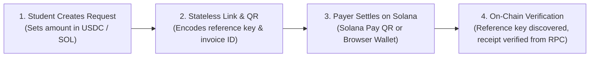

# ROTA — Cross-Border PayFi Remittance Router on Solana

> **Crypto World's Fair 2026 — Superteam Türkiye × Arf University Track Submission**  
> Developed by **Altan Çetin Çelik** (Pamukkale University, Department of Electrical & Electronics Engineering)  
> Live Demo: [rota-seven-eta.vercel.app](https://rota-seven-eta.vercel.app) | Portfolio: [altancelik.dev](https://altancelik.dev)

---

## 🎯 The Problem: Why Traditional Remittance Destroys Student Capital

Every year, tens of thousands of Turkish university students (Erasmus scholars, international students, and freelance developers) receive or send money cross-border. 

Under the traditional correspondent banking system (**SWIFT**, designed in 1973):
1. **$30 to $50 in flat fees** are deducted across 2–3 intermediary correspondent banks.
2. **Hidden Foreign Exchange Spreads** of **2.8% to 3.5%** are silently skimmed by retail commercial banks.
3. **Settlement latency** stretches across **3 to 5 business days**, with zero weekend clearing.
4. **PayPal has been banned in Türkiye since 2016**, cutting students off from global retail payment rails.

For a student receiving a **€550 monthly living stipend** or a young freelancer delivering a **$1,200 project milestone**, this correspondent friction wipes out significant funds, creating severe cash flow hardship.

---

## 💡 The Solution: ROTA PayFi Architecture

**ROTA** is an open-source, non-custodial cross-border payment request and verification tool built on **Solana**. Inspired by **Arf's** institutional thesis—*eliminating capital-intensive prefunding by settling cross-border transactions in real time via stablecoins*—ROTA brings that exact efficiency to university students and independent builders.



### Key Capabilities:
- **Stateless Payment Requests:** Create request links and Solana Pay QR codes instantly. No accounts, no database, no backend dependencies.
- **Spec-Compliant Solana Pay:** Fully implements the official [Solana Pay Specification](https://docs.solanapay.com/spec) with deterministic `reference` public keys and on-chain memo tracking.
- **Real On-Chain Verification:** When a transaction lands on Devnet, ROTA detects it via `getSignaturesForAddress(reference)`, pulls parsed on-chain transaction data, validates balances and fees, and generates a permanent verifiable receipt with genuine Solana Explorer links.
- **In-Browser Wallet Integration:** Direct settlement with detected Solana wallets (Phantom, Solflare, Backpack) on Devnet.
- **Live FX & Transparent Cost Comparison:** Ingests live mid-market exchange rates (`open.er-api.com`) and models realistic costs across SWIFT, Western Union, Wise, and ROTA (accounting for realistic exchange on/off-ramp spreads).

---

## ⚡ What Works Today (Devnet) vs. Next Steps

### ✅ Working in Production:
- [x] Full Next.js 16 (App Router + Turbopack) web interface deployed to Vercel
- [x] Stateless URL-encoded payment request creator (`/pay?r=...`)
- [x] Dynamic QR code generation for mobile Solana Pay wallets
- [x] Direct desktop browser wallet signing & devnet broadcast
- [x] Live RPC status badge (real slot height and RPC ping round-trip)
- [x] On-chain payment discovery and cryptographically verified digital receipt
- [x] Live mid-market currency rates with 30-minute caching

### 🔮 Roadmap:
- [ ] Solana Mainnet-Beta deployment (USDC & EURC)
- [ ] Local TRY on/off-ramp integration with licensed Turkish Virtual Asset Service Providers (VASPs)
- [ ] Recurring payment requests for monthly family allowances
- [ ] Campus ambassador pilot program at Pamukkale University student clubs

---

## 🛠️ Tech Stack

- **Framework:** Next.js 16 (App Router, Turbopack)
- **Language:** TypeScript 5.9
- **Styling:** Tailwind CSS 4.3 (Dark mode fintech UI)
- **Blockchain SDK:** `@solana/web3.js` (v1.99), Solana Pay Protocol, Solana Devnet RPC
- **FX Provider:** ExchangeRate-API via Next.js server route

---

## 🚀 Getting Started

### 1. Clone & Install
```bash
git clone https://github.com/AltanCetinCelik/rota.git
cd rota
pnpm install
```

### 2. Run Local Development Server
```bash
pnpm dev
```
Open [http://localhost:3000](http://localhost:3000) in your browser.

### 3. Build for Production
```bash
pnpm build
pnpm start
```

---

## 📜 Regulatory & Safety Disclosure

ROTA is client-side, non-custodial open-source software. It does not hold custody of user funds, operate custodial accounts, or execute private financial intermediation. Transactions settle peer-to-peer on the Solana blockchain.

---

## 👨‍💻 Author

**Altan Çetin Çelik**  
Electrical & Electronics Engineering, Pamukkale University  
- Website: [altancelik.dev](https://altancelik.dev)  
- GitHub: [github.com/AltanCetinCelik](https://github.com/AltanCetinCelik)  
- LinkedIn: [linkedin.com/in/altan-celik-004bb1248](https://linkedin.com/in/altan-celik-004bb1248)  
