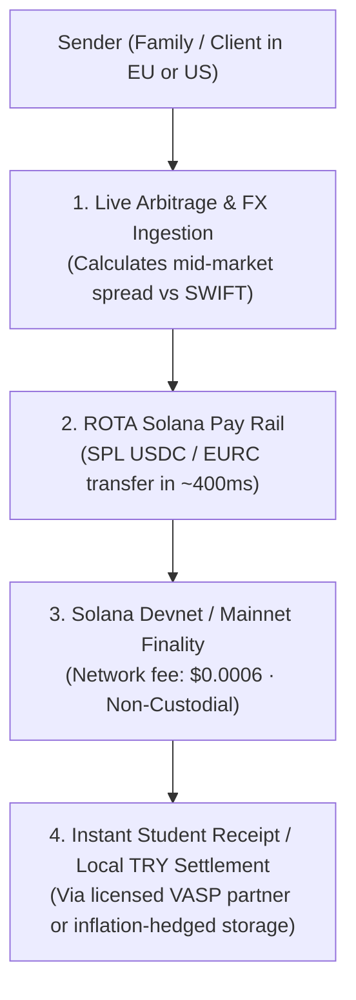

# ROTA — Cross-Border PayFi Remittance Router on Solana

> **Crypto World's Fair 2026 — Superteam Türkiye × Arf University Track Submission**  
> Developed by **Altan Çetin Çelik** (Pamukkale University, Department of Electrical & Electronics Engineering)  
> Live Demo: [rota-payfi.vercel.app](https://rota-payfi.vercel.app) *(Deploy pending)* | Portfolio: [altancelik.dev](https://altancelik.dev)

---

## 🎯 The Problem: Why Traditional Remittance Destroys Student Capital

Every year, tens of thousands of Turkish university students (Erasmus scholars, international students, and freelance developers) receive or send money cross-border. 

Under the traditional correspondent banking system (**SWIFT**, designed in 1973):
1. **$30 to $50 in flat fees** are deducted across 2–3 intermediary correspondent banks.
2. **Hidden Foreign Exchange Spreads** of **2.8% to 3.5%** are silently skimmed by retail commercial banks.
3. **Settlement latency** stretches across **3 to 5 business days**, with zero weekend clearing.

For a student receiving a **€500 monthly living stipend** or a young freelancer delivering a **$1,000 project milestone**, this correspondent friction wipes out up to **1,000+ TRY**, creating severe cash flow hardship.

---

## 💡 The Solution: ROTA PayFi Architecture

**ROTA** is an open-source, non-custodial cross-border payment router and remittance utility built on **Solana**. Inspired by **Arf's** institutional thesis—*eliminating capital-intensive prefunding by settling cross-border transactions in real time via stablecoins*—ROTA brings that exact efficiency to university students and independent builders.



### Key Capabilities:
- **Honest Multi-Rail Comparison Engine:** Ingests live FX spreads, bank wire costs, and remittance operator cuts, mathematically proving the exact net amount reaching the student's pocket.
- **Official Solana Pay Specification:** Generates dynamic, compliant `solana:<address>?amount=...&reference=...` QR codes and deep-links for instant Phantom/Solflare settlement.
- **On-Chain Devnet Simulator & Explorer Verifier:** Live transaction broadcaster and verifier that demonstrates sub-second finality (~400 ms) and provides clickable Solana Explorer confirmation signatures.
- **Bilingual Student & Freelancer Invoice Generator:** Produces print-ready, professional payment slips and PDF invoices with embedded Solana Pay QR codes.
- **Non-Custodial & Compliant:** ROTA holds zero user funds; transactions execute peer-to-peer on-chain, and off-ramps route through SPK/MASAK-compliant domestic platforms.

---

## 🛠️ Tech Stack

- **Framework:** Next.js 16 (App Router, Turbopack)
- **Language:** TypeScript 5.9
- **Styling:** Tailwind CSS 4.3 (Modern dark-mode fintech UI)
- **Blockchain SDK:** `@solana/web3.js` (v1.99), Solana Pay Protocol, Solana Devnet RPC
- **Telemetry:** Real-time FX & orderbook spread computation derived from quantitative trading architectures

---

## 🚀 Getting Started

### 1. Clone & Install
```bash
git clone https://github.com/AltanCetinCelik/rota.git
cd rota
pnpm install
```

### 2. Run Local Development Server
```bash
pnpm dev
```
Open [http://localhost:3000](http://localhost:3000) in your browser.

### 3. Build for Production
```bash
pnpm build
pnpm start
```

---

## 📜 Regulatory & Safety Disclosure

ROTA is a client-side routing and verification utility. It does not act as a custodian, bank, or centralized money transmitter. On-chain stablecoin movements occur non-custodially between sender and receiver wallets. Fiat conversions in the Republic of Türkiye are executed via licensed Turkish Virtual Asset Service Providers (VASPs).

---

## 👨‍💻 Author

**Altan Çetin Çelik**  
Electrical & Electronics Engineering, Pamukkale University  
- Website: [altancelik.dev](https://altancelik.dev)  
- GitHub: [github.com/AltanCetinCelik](https://github.com/AltanCetinCelik)  
- LinkedIn: [linkedin.com/in/altan-celik-004bb1248](https://linkedin.com/in/altan-celik-004bb1248)  
